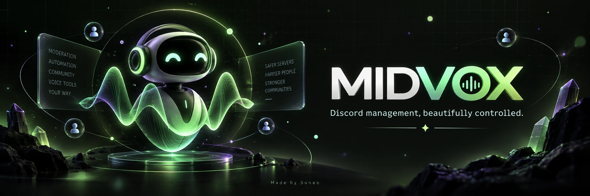
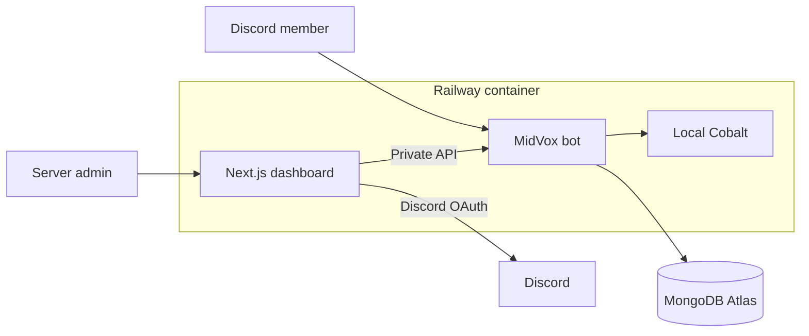

<div align="center">



<br />

[](https://www.python.org/)
[](https://nextjs.org/)
[](https://www.mongodb.com/atlas)
[](https://railway.com/)
[](LICENSE)

**One control center for moderation, automation, media, roles, logging, and community tools.**

[Open MidVox](https://midvox-production-7517.up.railway.app/) · [Dashboard](https://midvox-production-7517.up.railway.app/dashboard) · [Documentation](https://midvox-production-7517.up.railway.app/docs)

</div>

---

## Meet MidVox

MidVox is a full Discord management platform built for communities that want powerful automation without a fragmented setup. It combines a feature-rich Python bot, a responsive web dashboard, persistent per-server configuration, and private media processing in one Railway-ready service.

Every guild keeps its own settings in MongoDB Atlas, so configuration survives redeployments and moves cleanly between hosting accounts.

## What it can do

| Protect | Automate | Engage | Manage |
| :--- | :--- | :--- | :--- |
| Antinuke safeguards | Welcome flows | Games and activities | OAuth web dashboard |
| Advanced automod | Autoroles and reactions | Tickets and counting | Per-guild settings |
| Anti-spam controls | Logging and tracking | Media utilities | Persistent MongoDB storage |
| Moderation commands | Invite and vanity roles | YouTube Shorts handling | Custom and animated emojis |

### Built for real communities

- **Moderation suite** — bans, mutes, warnings, channel controls, message tools, and audit logging.
- **Layered protection** — continuous antinuke rollback, adaptive spam heat, raid panic, join gating, anti-link, anti-invite, anti-caps, and mass-mention defenses.
- **Burst-safe antinuke** — keeps audit-log enforcement active through rapid bans, kicks, channel or role destruction, bot additions, integrations, and webhook attacks.
- **Opt-in security suite** — command access lists, exact invite attribution, visual message evidence, attachment records, and a 25-message snipe history. Every new module starts disabled.
- **Server automation** — welcome messages, verification, autoroles, reaction roles, tickets, join-to-create, and custom roles.
- **Modern dashboard** — Discord OAuth, guild-aware navigation, responsive forms, and immediate settings updates.
- **Persistent configuration** — MongoDB-backed guild state survives restarts and Railway redeployments.
- **Private media pipeline** — a local Cobalt sidecar processes supported media inside the same container.
- **Community features** — games, counting, AI integrations, translation, QR tools, leveling, and leaderboards.

## How it fits together



| Component | Runtime | Role |
| :--- | :--- | :--- |
| Discord bot | Python 3.12 + discord.py | Commands, events, moderation, and automation |
| Internal API | Python on `127.0.0.1:5001` | Secure bridge between the dashboard and bot |
| Web dashboard | Next.js 14 on `0.0.0.0:8080` | OAuth login and guild configuration |
| Media service | Local Cobalt on `127.0.0.1:9000` | Private supported-media processing |
| Database | MongoDB Atlas | Durable, isolated settings for every guild |

## Deploy on Railway

MidVox ships as one production Docker image. Railway should build the repository `Dockerfile`; no custom build or start command is required.

1. Fork this repository and connect it to a Railway service.
2. Keep the repository root as the service root.
3. Confirm Railway detects the root `Dockerfile`.
4. Leave **Build Command** and **Start Command** empty.
5. Set the public domain target port to `8080`.
6. Add the required variables below and deploy.
7. Add `https://YOUR_DOMAIN/api/auth/callback/discord` as a redirect URL in the Discord Developer Portal.

> [!TIP]
> Use one replica. The bot, dashboard, database synchronizer, and local media service are coordinated inside the same container.

### Required variables

| Variable | Purpose |
| :--- | :--- |
| `TOKEN` | Discord bot token |
| `OWNER_IDS` | Comma-separated Discord IDs with owner access |
| `DISCORD_CLIENT_ID` | Discord OAuth application ID |
| `DISCORD_CLIENT_SECRET` | Discord OAuth client secret |
| `NEXTAUTH_SECRET` | Random secret used to sign dashboard sessions |
| `DASHBOARD_API_KEY` | Private key for dashboard-to-bot API requests |
| `NEXT_PUBLIC_DASHBOARD_API_KEY` | Matching key used by the dashboard proxy |
| `MONGO_URI` | MongoDB connection string for persistent guild settings |

`start.sh` derives `NEXTAUTH_URL` from Railway's public domain at runtime, which prevents OAuth redirects from pointing to an older deployment.

Public YouTube Shorts use local Cobalt with a renewable anonymous PoToken
session. YouTube can still challenge Railway's connection. For independent
hosted download routes, set `COBALT_HOSTED_PROVIDERS` to a JSON array of Cobalt
API endpoints whose operators permit your use. Example (place real keys only
in Railway Variables):

```json
[{"url":"https://your-provider.example","api_key":"your-key"}]
```

Up to three providers run in order before local Cobalt. Authentication uses
Cobalt's `Api-Key` scheme; omit `api_key` only for APIs that permit unauthenticated
requests. Oversized formats are skipped or stopped, empty/invalid files are
rejected, temporary files are cleaned up, and failed providers pause for five
minutes. No public instance is assumed reliable or added automatically.

<details>
<summary><strong>Optional variables</strong></summary>

| Variable | Default | Purpose |
| :--- | :--- | :--- |
| `PORT` | `8080` | Public dashboard port |
| `API_PORT` | `5001` | Internal bot API port |
| `COBALT_PUBLIC_URL` | local URL | Public base URL generated for Cobalt when required |
| `WARP` | `1` | Enables private WARP egress for datacenter media requests |
| `EMOJI_SYNC` | `false` | Enables startup emoji synchronization |
| `SUPPORT_URL` | repository URL | Support link shown by bot commands |

</details>

## Local development

Create a local environment from [`.env.example`](.env.example), then run the bot and dashboard separately.

```bash
python -m venv .venv
source .venv/bin/activate
pip install -r bot/requirements.txt
cp .env.example .env
cd bot && python midvox.py
```

In another terminal:

```bash
cd dashboard
npm install
npm run dev
```

On Windows PowerShell, activate Python with `.venv\Scripts\Activate.ps1`.

## Repository map

```text
MidVox
├── bot/
│   ├── api/                 Internal dashboard API
│   ├── cogs/                Commands, events, and automation
│   ├── core/                Bot framework extensions
│   ├── tests/               Focused regression tests
│   └── midvox.py            Bot entrypoint
├── dashboard/
│   ├── app/                 Next.js routes and pages
│   ├── components/          Dashboard interface and forms
│   └── lib/                 Authentication and API helpers
├── docker/                  Cobalt compatibility tooling
├── Dockerfile               Production multi-stage image
└── start.sh                 Container process supervisor
```

## Validation

```bash
python -m unittest discover -s bot/tests -v
cd dashboard && npm run build
bash -n start.sh
```

## Optional advanced security

The additional security modules are isolated per guild and remain disabled until an administrator enables them. Existing moderation and logging settings are not changed.

```text
securitysuite                         Show status
securitysuite channel #audit-log      Choose the advanced log channel
securitysuite logging on              Enable visual delete/edit evidence
securitysuite invites on              Enable exact invite attribution
allow @member                         Allow a member to use bot commands
allow @role                           Allow a role to use bot commands
securitysuite access on               Enforce the command whitelist

setup create vip @VIP                 Create a custom role word
setup allowrole vip @Staff            Let a role use that word
setup allowuser vip @Member           Let a member use that word
role                                  Open the role details dropdown
role @Member                          Open the dropdown and toggle a selected role
snipe 1                               Show the newest deleted message
snipe 25                              Show the oldest retained message
```

## Security

Keep bot tokens, OAuth secrets, cookie headers, API keys, and MongoDB credentials in Railway Variables or a local untracked `.env` file. Rotate any credential that appears in a commit, screenshot, log, or shared message.

## License

MidVox is available under the [MIT License](LICENSE) and retains the notices required by its upstream MIT-licensed source.

<div align="center">

### Made with care by [Suneo](https://github.com/suneo779)

**MidVox — safer servers, smoother communities.**

</div>
